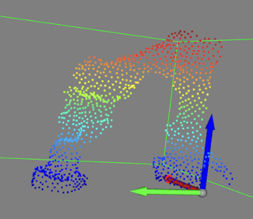
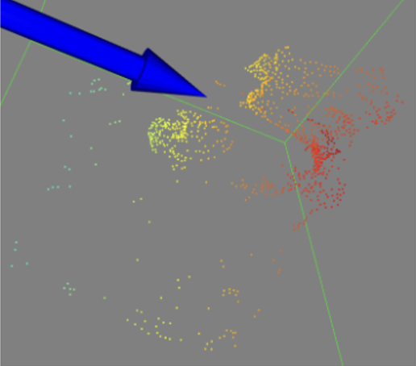

# Depth to Point Cloud for 3D Diffusion Policy

Depth-image conversion, workspace filtering, and fixed-size point sampling for a real-robot desktop manipulation project using [3D Diffusion Policy](https://arxiv.org/abs/2403.03954).

[Technical report](https://24zen0.github.io/files/3D_Diffusion_Policy_Technical_Report.pdf) · [Project and results](https://github.com/24zen0/Desktop-Cleaning-via-3D-Diffusion-Policy) · [Robot demo](https://24zen0.github.io/#diffusion-policy)

## Role in the project

The policy consumes a compact representation of the scene rather than a full depth image. This component explores how to project depth into 3D, retain the manipulation workspace, and sample 1,024 points for the policy input.

Yitao Zeng contributed point-cloud preprocessing within the team project and participated in the integrated calibration, demonstration, training, and deployment pipeline. Policy training and teleoperation are maintained in the [component repositories](https://github.com/24zen0/Desktop-Cleaning-via-3D-Diffusion-Policy#code-map).

## Processing workflow

```text
Depth frames in Zarr
    → pinhole back-projection using camera intrinsics
    → calibrated coordinate transformation
    → workspace filtering
    → farthest-point sampling
    → point-cloud observations for the policy
```

The files contain camera-specific development scripts and reusable functions. The workflow above describes the project pipeline; the scripts provide separate conversion, preprocessing, and visualization paths.

| Workspace cropping | Plane-filtering experiment |
| --- | --- |
|  |  |

These project diagnostics also appear in the technical report. The two panels illustrate different preprocessing approaches, rather than the same frame before and after processing. The project adopted workspace cropping and fixed-size sampling; RANSAC plane filtering was explored as an alternative.

## Code map

All Python modules are under [`Sustech_pcGenerate/`](Sustech_pcGenerate/).

| File | Purpose |
| --- | --- |
| [`Inputing_zarr.py`](Sustech_pcGenerate/Inputing_zarr.py) | Read the `depth` array; write a point-cloud array to a Zarr group |
| [`Convert_PointCloud.py`](Sustech_pcGenerate/Convert_PointCloud.py) | NumPy pinhole back-projection and an explicit camera-to-world transform |
| [`Cloud_Process.py`](Sustech_pcGenerate/Cloud_Process.py) | Workspace bounds, point preprocessing, and NumPy farthest-point sampling with optional PyTorch3D/CUDA |
| [`FilteringPlane.py`](Sustech_pcGenerate/FilteringPlane.py) | RANSAC plane detection, removal, and visualization helpers |
| [`RealSenseCamera.py`](Sustech_pcGenerate/RealSenseCamera.py) | Live RealSense depth acquisition and point-cloud visualization |
| [`Visualization.py`](Sustech_pcGenerate/Visualization.py) | Inspect saved point clouds with a workspace bounding box |
| [`VisDepth.py`](Sustech_pcGenerate/VisDepth.py) | Inspect depth data |
| [`main.py`](Sustech_pcGenerate/main.py) | Calibrated sequence conversion CLI with validity flags |

## Data interface

- **Input:** a Zarr group containing `depth`, with a frame sequence shaped `(T, H, W)`. If the recording has an outer `data` group, pass the path ending in `.zarr/data`.
- **Projection:** a depth frame plus camera intrinsics produces XYZ points. The conversion path applies the explicit camera-to-world transform once.
- **Sampling:** `farthest_point_sampling(points, num_points=1024, use_cuda=False)` takes an `(N, 3)` NumPy array and returns sampled XYZ points and their indices. CPU is the default; `use_cuda=True` opts into PyTorch3D/CUDA.
- **Storage:** `generate_pcd_zarr` writes a dataset named `pointcloud` by default. The CLI passes sequence chunks `(1, num_points, 3)` when saving frame sequences.

## Run the conversion

Install the CPU conversion dependencies and run the included synthetic example:

```bash
git clone https://github.com/24zen0/depth-to-pointcloud-for-dp3.git
cd depth-to-pointcloud-for-dp3
python -m pip install -r requirements.txt
python Sustech_pcGenerate/main.py examples/depth.npy output-example.zarr \
  --calibration examples/calibration.json
```

Expected summary: `{"shape": [2, 1024, 3], "valid_frames": 1, "total_frames": 2}`.
The example is a synthetic depth plane followed by an empty frame. It checks the
conversion interface; it is not a robot experiment or a camera calibration.
Choose a new output directory for each run; existing output is not overwritten.

For a recording, replace the input with the Zarr group containing `depth`:

```bash
python Sustech_pcGenerate/main.py path/to/recording.zarr/data output.zarr \
  --calibration path/to/camera.json
python -m unittest discover -s tests -v
```

## Calibration and output contract

Use your own calibration JSON with `width`, `height`, 3x3 `intrinsics`,
`depth_scale` (raw depth units per metre), 4x4 `camera_to_world`, and three
`workspace` bounds in metres. The example values are synthetic, not the
project camera calibration. The transform maps camera column vectors into the
workspace frame; translation is in metres.

The executable path projects depth once, applies the camera-to-workspace
transform once, crops in that frame, and performs farthest-point sampling.
`preprocess_point_cloud` takes already transformed metric points; it does not
scale or transform them again. CPU sampling is deterministic and requires no
GPU. Optional CUDA sampling through the function API requires PyTorch3D.

The output Zarr group contains `pointcloud` shaped `(T, 1024, 3)` by default and
`valid_frames` shaped `(T,)`. Empty/fully cropped frames remain zero-filled with
a false validity flag; downstream training must exclude or handle these frames.
When a valid crop has fewer than 1,024 points, selected points repeat to preserve
the policy input shape. `--num-points` changes the fixed count.

The original live-camera, RANSAC and visualization scripts remain separate
experiments with their own optional dependencies. The CPU example does not
exercise those scripts or establish real-robot policy performance.

## References and credit

- [3D Diffusion Policy](https://github.com/YanjieZe/3D-Diffusion-Policy) provides the underlying policy framework.
- [Project materials, authors, instructor, and related code](https://github.com/24zen0/Desktop-Cleaning-via-3D-Diffusion-Policy).
- Code is distributed under this repository's [MIT license](LICENSE).
